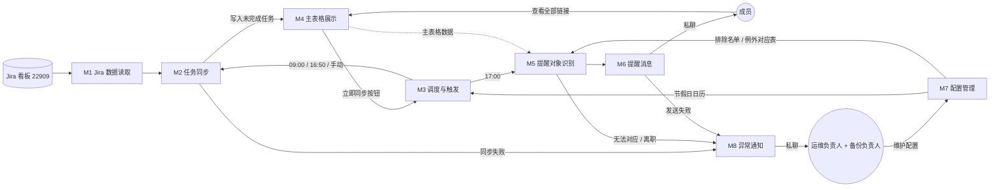
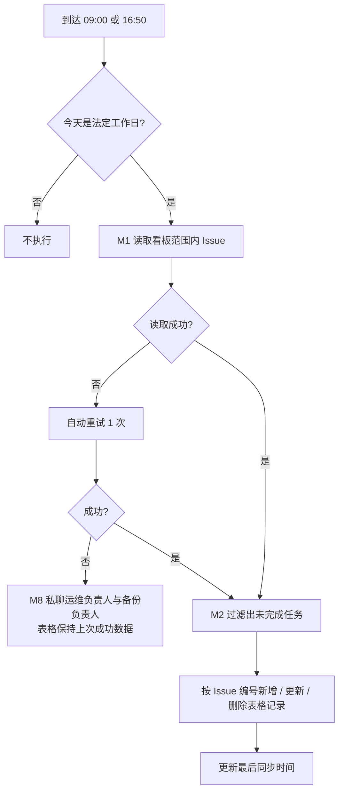
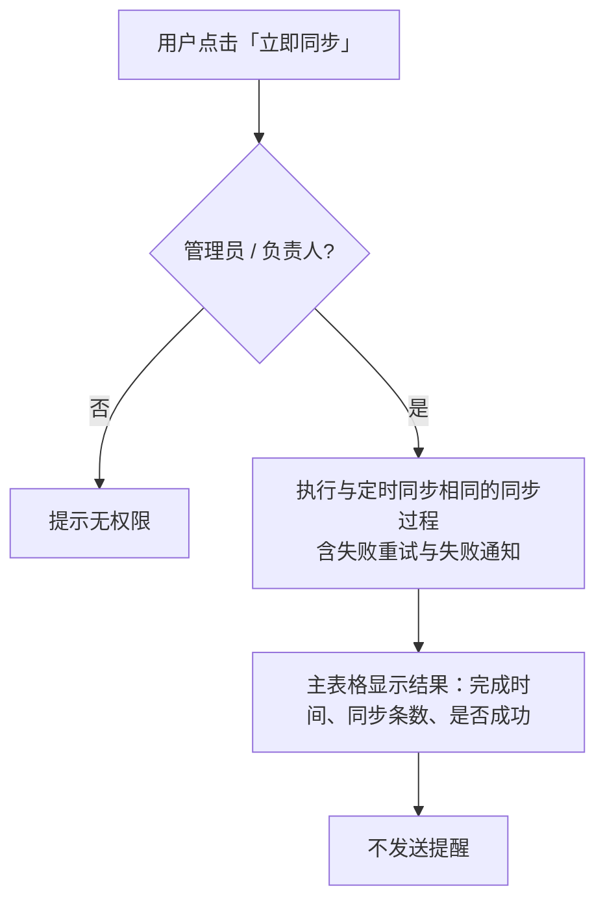
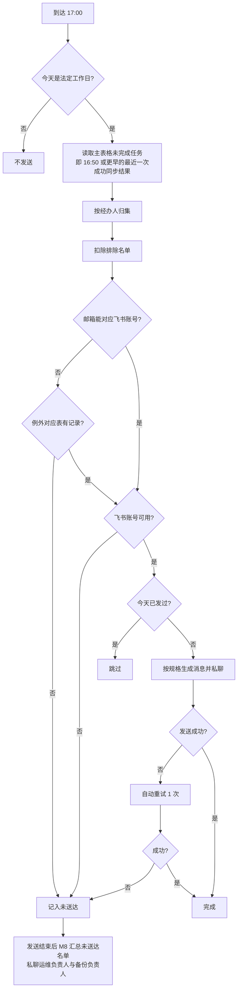

# QD助手 · 设计第一阶段：功能模块梳理

| 项目 | 内容 |
|---|---|
| 文档版本 | v0.2（待确认问题已全部确认） |
| 日期 | 2026-11-25 |
| 依据 | [`docs/需求文档.md`](../需求文档.md) v1.0；[`prototype/`](../../prototype/) 可交互原型 |
| 范围 | 功能梳理、模块划分、模块关系与核心流程、待确认问题 |
| 不含 | 技术选型、数据库设计、API 接口设计、代码开发 |

> 约定：本文只整理需求与原型中**已经存在**的功能，不擅自新增功能；唯一例外是审核中经你同意新增的功能 19（年底检查次年节假日日历，见 Q6、Q8）。原型中为演示而设的"顶部控制台"和"模拟 Jira"不属于产品功能，不纳入模块划分。原型中的 4 项假设（见原型 README）在本文中**不视为结论**，统一列入第 5 章待确认问题。

---

## 1. 产品定位回顾

**一句话**：每个法定工作日 17:00，通过飞书机器人私聊提醒项目组成员——他们在 Jira 看板 22909 范围内名下有哪些未完成的 Story / Task / Bug；同时提供一张只读的飞书多维表格，供成员和项目负责人查看全部未完成任务。

**三条贯穿全局的业务规则**（需求文档第 3 章）

| 规则 | 内容 |
|---|---|
| R1 单向只读 | Jira 是唯一数据源；表格只读，所有修改在 Jira 完成 |
| R2 只保留未完成 | 主表格只包含同步范围内状态类别非"完成"的任务 |
| R3 账号对应 | 默认按公司邮箱对应 Jira 与飞书账号；对不上的用例外对应表补充 |

---

## 2. 主要功能清单

按"谁在什么时候做什么"整理，括号内为需求编号。

| # | 功能 | 触发方 / 时机 | 需求依据 | 原型位置 |
|---|---|---|---|---|
| 1 | 读取看板范围内的 Story / Task / Bug 及其状态类别 | 每次同步 | F1.1 | — |
| 2 | 计算"未完成任务集合"，增 / 改 / 删主表格记录，按 Issue 编号去重 | 每次同步 | F1.2–F1.4、R2 | 模拟 Jira → 立即同步 |
| 3 | 更新"最后同步时间" | 每次成功同步 | F1.5 | 主表格标题栏 |
| 4 | 法定工作日 09:00、16:50 定时同步；非工作日不执行 | 系统定时 | F2.1 | 控制台按钮（模拟） |
| 5 | "立即同步"按钮，仅管理员 / 负责人可用；只更新表格、不发提醒；显示结果 | 管理员手动 | F2.2–F2.4 | 主表格「⟳ 立即同步」 |
| 6 | 主表格 12 个只读字段展示 | 用户查看 | 5.2 | 主表格 |
| 7 | 5 个视图：我的未完成 / 按人员 / 按项目 / 按报告人 / 状态看板 | 用户查看 | 5.3 | 主表格视图栏 |
| 8 | 视图使用说明 | 用户查看 | 5.3 备注 | 主表格「视图使用说明」 |
| 9 | 识别提醒对象：按经办人归集，扣除排除名单，完成账号对应 | 17:00 | F3.4、R3 | — |
| 10 | 生成提醒消息：每类总数 + 最多 3 条（按创建时间早→晚）+ 查看全部链接 + 数据截至时间 | 17:00 | 第 6 章 | 飞书消息 |
| 11 | 私聊发送提醒；名下无未完成任务不发；每人每工作日最多 1 条 | 17:00 | F3.1–F3.3 | 飞书消息 |
| 12 | 维护排除名单 | 运维负责人 | F4.2 | 管理表格 |
| 13 | 维护例外对应表 | 运维负责人 | F4.3 | 管理表格 |
| 14 | 维护节假日日历 | 运维负责人 | F4.4 | 管理表格 |
| 15 | 管理表格访问控制（仅运维负责人、备份负责人） | 访问时 | F4.1 | 管理表格「无权限」页 |
| 16 | 同步失败自动重试 1 次，仍失败私聊运维负责人 | 同步失败时 | F5.1 | 飞书消息「同步失败通知」 |
| 17 | 提醒未送达人员汇总后私聊运维负责人 | 17:00 发送后 | F5.2 | 飞书消息「未送达汇总」 |
| 18 | 16:50 同步失败时用上一次成功数据照常提醒，并注明数据截至时间 | 17:00 | F5.3 | 飞书消息卡片底部 |
| 19 | 🆕 年底检查次年节假日日历是否已录入，未录入则私聊提醒运维负责人与备份负责人 | 每年 12 月 1 日起每周一 09:00，直到录入为止（Q8） | **Q6 新增**（需求文档未包含） | 原型未实现 |

> 功能 19 为审核中经你同意新增的功能，其余均来自需求文档。

**明确不做**（需求文档 2.2，供模块边界参照）：回写 Jira、人工补充字段、群消息 / 汇总消息、历史任务、快照与趋势、同步 / 通知日志、超期判断、层级展示、处理「敏捷项目管理」、借鉴参考表格。

---

## 3. 功能模块划分

### 3.1 模块总览

| 模块 | 名称 | 一句话职责 | 对应功能 # |
|---|---|---|---|
| M1 | Jira 数据读取 | 从看板 22909 取回范围内的 Issue 及状态类别 | 1 |
| M2 | 任务同步 | 把 Jira 数据转换为"未完成任务集合"并写入主表格 | 2、3 |
| M3 | 调度与触发 | 判断法定工作日，按时触发同步与提醒；承接手动同步；年底检查次年日历 | 4、5、19 |
| M4 | 主表格展示 | 只读字段、5 个视图、使用说明、同步状态展示 | 6、7、8、5（结果展示部分） |
| M5 | 提醒对象识别 | 确定"该提醒谁"，并把 Jira 账号对应到飞书账号 | 9 |
| M6 | 提醒消息 | 生成符合规格的消息并私聊发送 | 10、11、18 |
| M7 | 配置管理（管理表格） | 维护排除名单、例外对应表、节假日日历及其访问控制 | 12–15 |
| M8 | 异常通知 | 同步失败、提醒未送达、日历未录入时通知运维负责人与备份负责人 | 16、17、19 |

### 3.2 各模块职责

#### M1 Jira 数据读取
- **职责**：按"看板 22909 所展示的范围"读取 Story、Task、Bug；获取 12 个字段所需的信息以及每条 Issue 的**状态类别**（待办 / 进行中 / 完成）。
- **输入**：看板范围定义（依赖 D1）。
- **输出**：看板范围内的 Issue 列表（含已完成，交由 M2 过滤）。
- **不负责**：判断是否未完成、写表格、任何修改 Jira 的操作（R1）。

#### M2 任务同步
- **职责**：
  - 过滤出状态类别非"完成"的 Issue（R2）；
  - 以 Issue 编号为唯一标识，对主表格做新增、更新、删除，使"表格 = 未完成集合"；
  - 成功后更新"最后同步时间"；
  - 失败时自动重试 1 次（F5.1 的重试部分）。
- **输入**：M1 的 Issue 列表；M3 的触发指令（含触发来源：09:00 / 16:50 / 手动）。
- **输出**：更新后的主表格数据；同步结果（成功 / 失败、条数、时间）→ M3（手动结果展示）、M8（失败通知）、M6（数据截至时间）。
- **不负责**：决定何时同步（M3）、发送通知（M8）。

#### M3 调度与触发
- **职责**：
  - 依据节假日日历判断当天是否**法定工作日**（法定节假日不算，调休补班日算）；
  - 工作日 09:00、16:50 触发 M2；17:00 触发 M5 → M6；
  - **日历缺失时的判断规则**（已确认，Q6）：某日期所在年份未录入节假日日历时，按"周一至周五为工作日"判断；
  - **年底日历检查**（Q6 新增）：年底检查次年节假日日历是否已录入，未录入则交 M8 通知。检查时间：**每年 12 月 1 日起，每周一 09:00 检查一次，直到次年日历录入为止**（已确认，Q8）；
  - 承接主表格"立即同步"：校验操作者是否为管理员 / 负责人（朱卓为所有者，胡桓康为管理员，Q2 已确认），触发 M2，且**不触发提醒**（F2.3）；
  - 把手动同步结果交给 M4 展示（F2.4）。
- **输入**：M7 的节假日日历；时间；手动操作及操作者身份。
- **输出**：对 M2、M5/M6 的触发；手动同步结果。
- **不负责**：同步与发送的具体逻辑。

#### M4 主表格展示
- **职责**：
  - 以只读方式展示 12 个字段（R1）；
  - 提供 5 个视图：我的未完成（按当前查看者筛选，提醒链接的落点）、按人员、按项目、按报告人、状态看板（待办 / 进行中两列）；
  - 显示最后同步时间、手动同步结果、视图使用说明；
  - **手动同步结果**（已确认，Q7）：对所有查看者可见，一直显示到下一次手动同步；内容为完成时间、同步条数、是否成功，并标明是"手动同步"的结果（定时同步不更新这条结果，最新数据时间以"最后同步时间"为准）；
  - 提供"立即同步"入口（权限校验由 M3 负责）。
- **人员展示规则**（已确认，Q1）：
  - "经办人""报告人"按 R3 对应后显示为**飞书人员**；
  - 对应不上的人员（如外部账号、已离职）显示 **Jira 姓名并标注"未对应"**；
  - "我的未完成"按**飞书人员**识别当前查看者；未对应人员的任务会出现在"按人员查看"等视图中，但不会出现在任何人的"我的未完成"里；
  - 字段数保持 12 个，不新增列。
- **位置与归属**：放在「敏捷项目管理」所在知识库，所有者朱卓；查看权限随知识库成员。
- **输入**：M2 写入的数据；M3 的手动同步结果。
- **不负责**：数据计算、任何编辑能力。

#### M5 提醒对象识别
- **职责**：
  - 以主表格中的未完成任务为依据，按**经办人**归集；
  - 扣除 M7 排除名单中的人员；
  - 按公司邮箱把 Jira 账号对应到飞书账号；对不上时查 M7 例外对应表；
  - 识别无法送达的人员（账号无法对应、飞书账号已停用 / 离职），交给 M8。
- **输入**：主表格数据；M7 的排除名单、例外对应表；飞书通讯录。
- **输出**：可送达的"飞书账号 → 名下未完成任务"清单 → M6；未送达名单 → M8。
- **说明**：账号对应规则（R3）由 M5 统一定义，M4 的人员展示与"我的未完成"筛选使用**同一套对应结果**（已确认，Q1），保证"提醒发给谁"与"谁在我的未完成里看到这些任务"一致。

#### M6 提醒消息
- **职责**：
  - 某类数量为 0 时仍显示该类，写作"共 0 条"（已确认，Q5），保证每条消息结构一致；
  - 按第 6 章规格生成消息：提醒语 → Story / Task / Bug 各自"共 N 条"与最多 3 条（按创建时间早→晚，每条为编号（可跳转 Jira）+ 标题 + Jira 状态）→"查看全部 → 我的未完成"链接 → 数据截至时间；
  - 私聊发送给每位提醒对象；名下无未完成任务不发；每人每工作日最多 1 条定时提醒；
  - 发送出错时**自动重试 1 次**，仍失败才计入未送达（已确认，Q4）；账号无法对应、已离职不重试，直接计入未送达；
  - "数据截至时间"取最近一次**成功**同步的时间（覆盖 F5.3 场景）。
- **输入**：M5 的清单；M2 的最近成功同步时间。
- **输出**：私聊消息；发送失败人员 → M8。

#### M7 配置管理（管理表格）
- **职责**：维护三类配置，并限制只有运维负责人与备份负责人可访问：
  - **排除名单**：不接收提醒的人员；
  - **例外对应表**：Jira 账号 ↔ 飞书账号；
  - **节假日日历**：法定节假日、调休补班日。
- **生效方式**：修改后**下一次**执行即生效（F4 验收标准）。
- **使用方**：M3（日历）、M5（排除名单、例外对应表）。
- **不包含**：日志（已取消）。

#### M8 异常通知
- **职责**：
  - 同步重试后仍失败 → 发送同步失败通知，说明失败的同步、原因，以及表格保持的数据截至时间；
  - 17:00 发送后，汇总当天未送达人员（账号无法对应、离职、发送失败）→ 发送未送达汇总；
  - 年底检查发现次年节假日日历未录入 → 发送"请录入次年节假日日历"提醒（Q6 新增）；
  - **通知对象**（已确认，Q3）：所有异常通知**同时私聊运维负责人（胡桓康）和备份负责人（朱卓）**；由运维负责人处理，运维负责人不在时由备份负责人接替。
- **输入**：M2 的失败结果；M5、M6 的未送达名单。
- **不负责**：记录日志（F5.4：失败信息只通过通知传达）。

### 3.3 横向关注点：角色与权限

| 能力 | 研发 / 测试 | 项目负责人 / 表格管理员 | 运维负责人（胡桓康） | 备份负责人（朱卓） | 所在模块 |
|---|---|---|---|---|---|
| 查看主表格 | ✅ | ✅ | ✅ | ✅ | M4 |
| 修改主表格数据 | ❌ | ❌ | ❌ | ❌ | M4（R1） |
| 立即同步 | ❌ | ✅ | ✅（主表格管理员，Q2） | ✅（所有者） | M3 |
| 访问管理表格 | ❌ | ❌ | ✅ | ✅ | M7 |
| 接收 17:00 提醒 | 名下有未完成时 | 名下有未完成时 | 名下有未完成时 | 名下有未完成时 | M5、M6 |
| 接收异常通知 | ❌ | ❌ | ✅（负责处理） | ✅（同时接收，必要时接替，Q3） | M8 |

---

## 4. 模块关系与核心业务流程

### 4.1 模块关系图

**依赖要点**
- 提醒（M5、M6）**只读取主表格中的数据**，不直接读 Jira；因此 17:00 提醒的准确性取决于 16:50 同步（F3.2）。
- M7 是唯一的配置来源；M3、M5 只读取配置，不修改。
- M8 只接收其他模块的异常结果，不反向影响同步或发送。

### 4.2 流程一：定时同步（09:00 / 16:50）

### 4.3 流程二：手动同步（立即同步）

- 周末和法定节假日也可手动同步（F2 验收标准）。

### 4.4 流程三：17:00 个人提醒

### 4.5 流程四：成员查看与处理任务

1. 成员收到 17:00 私聊提醒；
2. 点击某条任务编号 → 跳转 Jira 对应 Issue，在 Jira 中更新状态；
3. 或点击"查看全部 → 我的未完成" → 打开主表格"我的未完成"视图，查看名下全部未完成任务；
4. 次个工作日 09:00 同步后，已完成的任务从表格中消失（R2）。

### 4.6 流程五：配置维护

1. 运维负责人收到"未送达汇总"（例如某人邮箱对不上）；
2. 打开管理表格，在例外对应表补充对应关系，或把不该提醒的人加入排除名单；
3. 下一次 17:00 提醒即按新配置执行；
4. 每年在节假日日历中录入法定节假日和调休补班日（D6）；年底若次年日历仍未录入，运维负责人与备份负责人会收到录入提醒（Q6）。

---

## 5. 尚不明确、需要进一步确认的问题

### 5.1 新识别的问题（需要你决定）

| # | 问题 | 为什么要确认 / 影响的模块 | 原型现状（仅供参考，非结论） |
|---|---|---|---|
| ~~Q1~~ | ~~主表格"经办人""报告人"展示成什么？"我的未完成"按什么识别查看者？~~ | ✅ **已确认（方案 A）**：按飞书人员展示；未对应者显示 Jira 姓名并标注"未对应"；"我的未完成"按飞书人员筛选；字段仍为 12 个 | — |
| ~~Q2~~ | ~~运维负责人是否具备主表格管理员权限、能否点"立即同步"？~~ | ✅ **已确认（方案 A）**：胡桓康为主表格管理员，可点"立即同步"；需由所有者朱卓授予 | — |
| ~~Q3~~ | ~~异常通知是否同时发给备份负责人？~~ | ✅ **已确认（方案 B）**：同步失败通知、未送达汇总均同时私聊胡桓康与朱卓；胡桓康负责处理，朱卓必要时接替 | — |
| ~~Q4~~ | ~~提醒消息发送失败时，是否也自动重试 1 次？~~ | ✅ **已确认（方案 B）**：发送出错重试 1 次，仍失败才计入未送达；账号无法对应、离职不重试 | — |
| ~~Q5~~ | ~~某一类任务数量为 0 时，显示"共 0 条"还是省略？~~ | ✅ **已确认（方案 A）**：显示"共 0 条"，三类始终都出现 | — |
| ~~Q6~~ | ~~节假日日历没有录入某一年时怎么判断工作日？~~ | ✅ **已确认（方案 C）**：未录入年份按周一至周五判断；并**新增**年底检查与录入提醒（通知运维负责人与备份负责人） | — |
| ~~Q7~~ | ~~手动同步结果对谁可见、保留多久？~~ | ✅ **已确认（方案 A）**：所有查看者可见，显示到下一次手动同步 | — |
| ~~Q8~~ | ~~年底日历检查在什么时间进行、提醒几次？~~ | ✅ **已确认（方案 B）**：12 月 1 日起每周一 09:00 检查，未录入就提醒，录入后停止 | — |

### 5.2 需求文档遗留的依赖项（不影响模块划分，开发前补齐）

| # | 事项 | 影响模块 |
|---|---|---|
| D1 | 看板 22909 的小部件 / 筛选器定义 | M1 |
| D2 | 工作流状态名及其状态类别核对 | M1、M2 |
| D3 | 提醒对象是否都是知识库成员 | M4、M6 |
| D4 | 朱卓确认担任备份负责人与主表格所有者 | M4、M7、M8 |
| D5 | 知识库管理员同意放入新表格 | M4 |
| D6 | 节假日日历首次录入 | M7 |
| D7 | 朱卓将胡桓康设为主表格管理员（来自 Q2 结论） | M3、M4 |

---

## 6. 本阶段结论摘要

1. 产品可划分为 **8 个功能模块**：Jira 数据读取、任务同步、调度与触发、主表格展示、提醒对象识别、提醒消息、配置管理、异常通知。
2. **主表格是系统的中枢**：同步写入它，提醒读取它，用户查看它；提醒不直接读 Jira。
3. **配置管理只提供三类配置**，被调度（日历）和提醒对象识别（排除名单、例外对应）使用。
4. **异常只通过私聊通知传达**，不记录日志。
5. 新识别 8 个问题（Q1–Q8，其中 Q8 由 Q6 的结论引出）：**Q1–Q8 已全部确认**，可以进入下一阶段设计。
6. 审核中经你同意**新增 1 项功能**：年底检查次年节假日日历并提醒录入（功能 19）。

## 附录 A：对需求文档的补充与细化

以下结论细化了需求文档中未写明的部分，建议在需求文档下一版中同步：

| 需求条目 | 原文 | 细化后 | 来源 |
|---|---|---|---|
| 第 7 章 立即同步 | 运维负责人"（如具备管理员权限）" | 胡桓康为主表格管理员，可立即同步 | Q2 |
| F5.1 / F5.2 | 私聊通知运维负责人；备份负责人可接替 | 同时私聊运维负责人与备份负责人 | Q3 |
| F5.1 / F5.2 | 重试 1 次仅针对同步失败 | 提醒发送出错也重试 1 次，仍失败才计入未送达 | Q4 |
| 6.2 数量为 0 | 可省略或显示"共 0 条"，设计阶段确定 | 显示"共 0 条" | Q5 |
| F2.4 手动同步结果 | 在表格中显示结果 | 所有查看者可见，显示到下一次手动同步 | Q7 |
| F4.4 节假日日历 | 只规定维护日历 | 未录入年份按周一至周五判断；🆕 新增年底检查次年日历（12 月 1 日起每周一 09:00），未录入则提醒运维负责人与备份负责人 | Q6、Q8 |
| 5.2 经办人 / 报告人 | 未规定展示形式 | 按飞书人员展示，未对应者显示 Jira 姓名并标注"未对应" | Q1 |

## 附录 B：审核决策记录

| # | 问题 | 结论 | 日期 |
|---|---|---|---|
| Q1 | 经办人 / 报告人展示与"我的未完成"识别规则 | A：按飞书人员展示，未对应者显示 Jira 姓名并标注"未对应"，按飞书人员筛选 | 2026-11-25 |
| Q2 | 运维负责人能否"立即同步" | A：能，胡桓康为主表格管理员（由朱卓授予） | 2026-11-25 |
| Q3 | 异常通知是否同时发给备份负责人 | B：同时私聊胡桓康与朱卓 | 2026-11-25 |
| Q4 | 提醒发送失败是否重试 | B：重试 1 次，仍失败计入未送达 | 2026-11-25 |
| Q5 | 某类数量为 0 时的显示 | A：显示"共 0 条" | 2026-11-25 |
| Q6 | 节假日日历未录入时怎么判断 | C：按周一至周五判断 + 新增年底提醒录入 | 2026-11-25 |
| Q7 | 手动同步结果的可见范围 | A：所有查看者可见，显示到下一次手动同步 | 2026-11-25 |
| Q8 | 年底日历检查的时间与频率 | B：12 月 1 日起每周一 09:00 检查，录入后停止 | 2026-11-25 |
