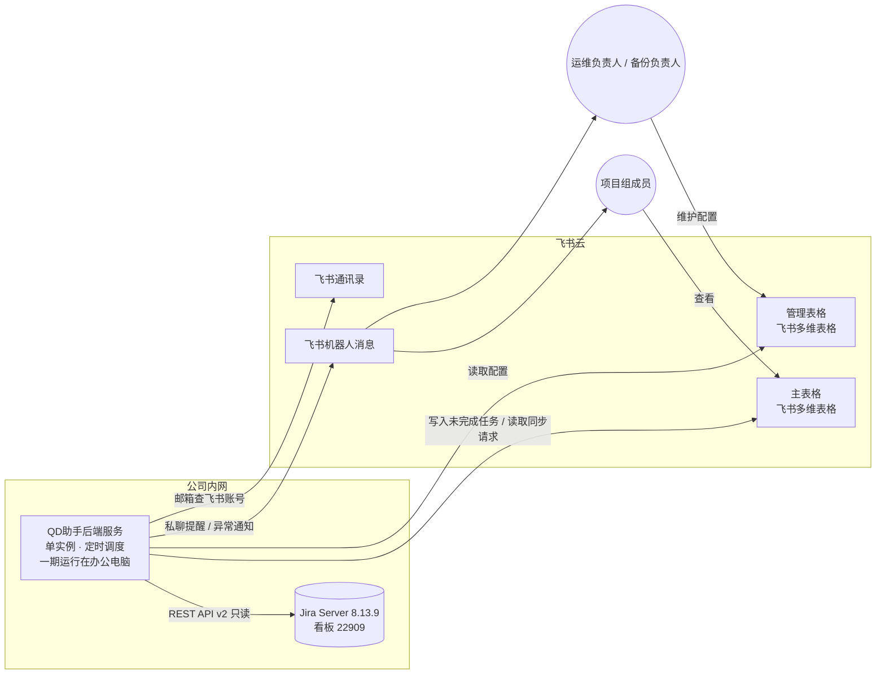
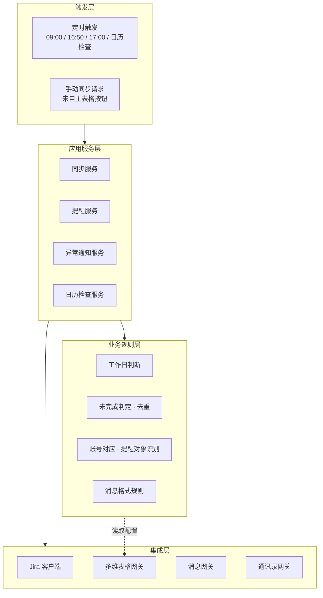
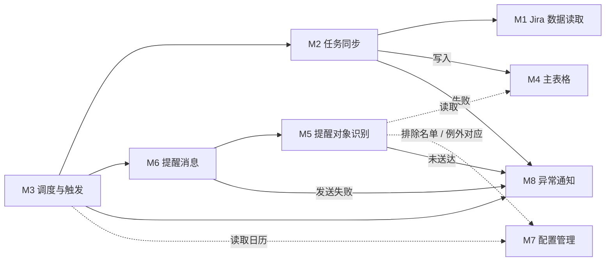

# QD助手 · 设计第二阶段：技术选型与整体架构设计

| 项目 | 内容 |
|---|---|
| 文档版本 | v1.2（已审核通过；2026-11-26 修正 E2、补充工作流评估，并按 03 同步立即同步方案） |
| 日期 | 2026-11-25 |
| 依据 | [`01.功能模块梳理.md`](01.功能模块梳理.md) v0.2（现已更新至 v0.3）；[`需求文档.md`](../需求文档.md) v1.0（现已更新至 v1.1）；[`prototype/`](../../prototype/) |
| 范围 | 技术选型、整体架构、模块架构、项目目录、关键决策与风险 |
| 不含 | 表结构、接口定义、业务代码 |

> **状态标记**：
> - 🔒 **约束**：由需求或现有环境决定，非选型结果；
> - ✅ **已确认**：经你审核确认；
> - 💡 **建议（待确认）**：我的建议及依据，**未经确认不作为既定方案**，对应第 6 章的待确认问题。

---

## 1. 设计输入：已知约束

### 1.1 来自需求与第一阶段设计的约束 🔒

| # | 约束 | 来源 | 对架构的影响 |
|---|---|---|---|
| C1 | 主表格、管理表格都是**飞书多维表格** | 需求 5.1、F4 | 系统**无需自建 Web 前端**；展示与配置编辑由飞书承担 |
| C2 | 提醒与异常通知通过**飞书机器人私聊** | F3.1、F5、Q3 | 需要飞书自建应用（机器人能力） |
| C3 | Jira 是唯一数据源，只读 | R1 | 只需 Jira 读权限，不写 Jira |
| C4 | 不记录日志、快照、历史任务 | 需求 2.2 | 业务数据只有"当前未完成任务"和"配置"，**数据量小、无历史** |
| C5 | 定时任务：法定工作日 09:00、16:50 同步，17:00 提醒；12 月起每周一 09:00 日历检查 | F2.1、F3.1、Q8 | 需要可靠的定时调度（北京时间） |
| C6 | "立即同步"按钮在主表格**仪表盘**内（按钮组件，03 Q2），仅管理员 / 负责人可用 | F2.2、Q2 | 需要从飞书多维表格触发后端执行 |
| C7 | 每人每工作日最多 1 条定时提醒；失败重试 1 次 | F3、F5.1、Q4 | 需要防重复发送；需要重试机制 |

### 1.2 来自现有环境的约束（已实际核查） 🔒

| # | 事实 | 核查方式 | 对架构的影响 |
|---|---|---|---|
| E1 | Jira 为 **Jira Server 8.13.9**（自建，非云版） | 访问 `/rest/api/2/serverInfo` | 使用 Jira REST API v2；**8.13 不支持个人访问令牌（PAT，8.14 起提供）**，只能用账号密码（Basic Auth）等方式认证 |
| E2 | ~~`jira.dreame.tech` 解析到内网地址，只能经企业 VPN 访问~~ **（2026-11-26 修正）**：飞书云端（多维表格工作流）可**匿名**访问 Jira，请求经公司 API 网关（Kong）转发；**带账号的访问从外网尚未验证成功**（测试账号因登录失败被要求验证码，见 R11）。本机解析到的 `198.19.x.x` 应为 VPN 软件的虚拟地址，不能据此判断"仅内网" | 本机网络探测；飞书工作流 HTTP 测试（GET serverInfo 返回 200；GET myself 不带认证 401、带认证 403 + CAPTCHA_CHALLENGE） | 后端运行在能访问 Jira 并完成认证的位置即可；一期办公电脑经 VPN 访问仍满足（Q2）。外网带认证访问未验证（验证已暂停，见第 9 章），暂不作为设计依据 |
| E5 | Jira 前置网关限流：**每分钟 100 次**（`X-Ratelimit-Limit-Minute: 100`） | 飞书工作流 HTTP 测试返回头 | 同步分页拉取需控制请求频率 |
| E3 | 飞书开放平台已有自建应用 **QD助手**（`cli_ab8f80e2a9b99cf7`），已具备机器人、多维表格、消息、通讯录等权限，并已实测读写多维表格、私聊发消息 | 前期 MCP 配置与测试 | 可直接复用，减少开通成本（是否复用待确认） |
| E4 | 开发机已有 JDK、Maven、IntelliJ IDEA（仓库内已有 `.idea/`） | 本机检查 | 团队可能以 Java 为主（推测，待确认） |

---

## 2. 技术选型

### 2.1 选型总览

| 层面 | 方案 | 状态 | 依据摘要 |
|---|---|---|---|
| 前端 | **不自建前端**；使用飞书多维表格（主表格、管理表格）+ 飞书消息卡片 | 🔒 约束 | C1、C2；原型中的网页只用于演示 |
| 后端语言 / 框架 | Java 21（LTS）+ Spring Boot 3.x | ✅ 已确认（Q1） | 见 2.2 |
| 定时调度 | Spring 内置定时任务（cron，时区 Asia/Shanghai）；**启动时检查当天错过的定时点并补执行**（见 2.5） | ✅ 随 Q1 确认；补执行规则 Q8 确认 | 定时点固定且少；单实例即可，无需分布式调度框架 |
| Jira 接入 | Jira REST API v2 + Basic Auth；**一期使用胡桓康的个人 Jira 账号**，后续可替换为专用只读服务账号 | ✅ 已确认（Q4） | E1：8.13.9 不支持 PAT；账号通过配置注入，替换账号无需改代码 |
| 飞书接入 | 飞书官方服务端 SDK（Java 版 `oapi-sdk-java`），应用身份（tenant_access_token）；**复用现有自建应用 QD助手（`cli_ab8f80e2a9b99cf7`）** | ✅ 已确认（Q1、Q5） | 官方维护，内置令牌获取与刷新；前期已验证应用身份可读写表格、发消息 |
| 数据库 | **不引入独立数据库**（业务数据全部存放在飞书多维表格；当日已发送状态存本地状态文件） | ✅ 已确认（Q3） | 见 2.3 |
| 缓存 | **不引入 Redis 等缓存组件** | ✅ 已确认（Q3） | 见 2.3 |
| 部署 | **一期：个人办公电脑运行（单实例）**；后续视情况迁移到公司内网服务器（Docker）或公司容器平台 | ✅ 已确认（Q2） | E2：办公电脑经 VPN 可访问 Jira，也能访问飞书；单实例天然避免重复触发。迁移前需关注可用性风险 R9 |
| 配置与密钥 | 环境变量 / 外部配置文件注入，不入代码仓库 | ✅ 已确认 | 飞书 App Secret、Jira 账号密码属于敏感信息 |
| 运行日志 | 程序运行日志写本地文件，**保留 7 天**自动清理；不写入飞书表格、不对用户展示；不记录密码、App Secret 等敏感信息 | ✅ 已确认（Q7） | 区别于需求取消的业务日志（同步日志 / 通知日志），仅用于故障排查 |

### 2.2 后端语言与框架（✅ 已确认：Java 21 + Spring Boot 3）

| 候选 | 优点 | 不足 |
|---|---|---|
| **Java 21 + Spring Boot 3**（建议） | 开发机已具备 Java 工具链与 IDEA（E4）；飞书官方提供 Java SDK；Spring 自带定时任务、配置管理、HTTP 客户端，组件齐全；企业内常见，便于后续维护交接 | 相对 Python 代码量稍多；镜像体积稍大 |
| Python 3 + APScheduler | 代码量小，脚本化快 | 长期运行服务的工程化（配置、测试、部署规范）需要自行组织；团队技术栈不明 |
| Node.js（TypeScript） | 飞书 SDK 同样成熟 | 同上，团队技术栈不明 |

> 依据：本系统是"定时拉取 + 计算 + 写表 + 发消息"的后台服务，没有高并发和复杂交互，任何主流语言都能胜任，**选择的关键是团队熟悉度和可维护性**。根据开发环境（E4）推测团队以 Java 为主，因此建议 Java；若团队另有主力语言，以团队为准。

### 2.3 为什么建议不引入数据库与缓存

| 需要保存的数据 | 存放位置 | 说明 |
|---|---|---|
| 未完成任务（主表格） | 飞书多维表格（主表格） | 需求要求在飞书中展示；每次同步以 Jira 为准整体重算，不需要另存一份 |
| 排除名单、例外对应表、节假日日历 | 飞书多维表格（管理表格） | 需求 F4 规定由运维负责人在管理表格维护 |
| 最后一次成功同步时间 | 主表格"最后同步时间"字段 | 已是需求字段，可直接读取 |
| 手动同步结果 | 不单独存储；由主表格仪表盘统计组件（最后同步时间、任务数）体现，失败走异常通知 | 03 Q2 修订 |
| **当日已发送提醒的人员**（防重复，C7） | ✅ 本地状态文件（Q3） | 仅记录"日期 + 已发送人员"，只保留当天，次日覆盖；不含任务内容，不属于业务日志；迁移到服务器后放在挂载的数据目录 |
| 飞书访问令牌 | SDK 内存缓存 | SDK 自动刷新 |

- 需求明确**不保留历史、不记录日志**（C4），业务数据只有"当前状态 + 配置"，且都必须放在飞书里给人看和改；再建一个数据库会出现**两份数据需要保持一致**的问题。
- 数据量小（单看板的未完成任务通常在数百条以内），无高频读写，**缓存没有收益**。
- 唯一需要"记住"的运行状态是"今天已经给谁发过提醒"。由于一期运行在办公电脑上（Q2），重启较频繁，已确认使用**本地状态文件**保存（Q3），重启后不会重复发送，且仍无需数据库。

### 2.4 "立即同步"按钮的触发方式（需验证）

飞书多维表格中的按钮需要让后端开始同步，并且能识别**是谁点的**（Q2 权限）。由于一期后端运行在办公电脑（Q2，位于 VPN / NAT 之后、无公网地址），**飞书服务器无法主动访问后端**（此结论与 E2 修正无关：E2 讨论的是"后端访问 Jira"，这里是"飞书访问后端"），常见的"按钮→自动化→发送 HTTP 请求到后端"方案不可行。候选方案：

| 方案 | 做法 | 优点 | 不足 |
|---|---|---|---|
| A. 按钮写"同步请求"标记 + 后端轮询 | 按钮触发多维表格自动化，把某条记录标记为"请求同步"（并带上操作人）；后端每分钟检查一次标记，执行同步后清除标记并回写结果 | 不需要外网访问内网；完全使用飞书原生能力 | 最长约 1 分钟延迟；需验证按钮能否记录操作人、权限能否限制 |
| B. 按钮触发事件 + 长连接订阅 | 按钮修改记录 → 飞书推送"记录变更"事件 → 后端通过飞书 SDK 的**长连接**模式接收（后端主动连飞书，无需公网地址） | 近实时 | 需验证多维表格记录变更事件在长连接模式下可用、事件中能拿到操作人 |
| C. 按钮打开内网链接 | 按钮打开后端的内网网页地址，点击者需在公司网络内 | 实现直观 | 需要在网页中识别飞书用户身份（网页免登），工作量明显增加 |

> 📌 2026-11-26 补充（03 Q2）：按钮采用**主表格仪表盘的按钮组件**；后端得知点击的方式优先"流程向 QD助手 会话发消息、后端经长连接接收"（无需数据表），其次"写入请求记录"（见 03 V2、V3）。
>
> ✅ 已确认（Q6）：**开发前先做技术验证（PoC），优先 B（长连接事件），A（轮询）作为保底**。PoC 需验证：① 多维表格记录变更事件能否通过长连接接收；② 事件或记录中能否取得"点击人"；③ 按钮能否限制仅管理员 / 负责人可点。任一项不满足，则切换到 A，并在 A 中同样验证②③。

### 2.5 错过定时点的补执行规则（✅ 已确认，Q8）

> 由一期在办公电脑运行（Q2）引出的**新增处理逻辑**，需求文档未包含，经你同意加入。

| 情况 | 处理 |
|---|---|
| 开机 / 恢复在线时，当天（法定工作日）错过了 09:00 或 16:50 同步 | 立即补同步一次 |
| 当天错过了 17:00 提醒，且当前时间早于**截止时间 20:00** | 先补同步，再补发提醒 |
| 已过 20:00，或已是第二天 | 不再补发前一天 / 当天的提醒 |
| 补发与正常提醒 | 规则一致；每人每天最多 1 条（依靠本地状态文件防重复，Q3） |
| 非法定工作日 | 不补执行（与正常定时规则一致） |

- 截止时间 20:00 按建议值确定，可通过配置调整。
- 年底日历检查（每周一 09:00）不在补执行范围内；如需要可后续补充。

---

## 3. 整体架构设计

### 3.1 系统上下文



- **所有连接都由后端主动发起**（访问 Jira、访问飞书开放平台），不需要外部访问内网。
- 用户只与飞书交互（看消息、看表格、改配置），**不直接访问后端**。

### 3.2 技术分层



| 层 | 职责 | 不负责 |
|---|---|---|
| 触发层 | 按北京时间在规定时刻触发；启动时检查并补执行当天错过的定时点（2.5）；接收手动同步请求并校验操作人权限；保证同一时刻只有一个同步在执行 | 业务计算 |
| 应用服务层 | 编排一次完整的业务动作：同步、提醒、异常通知、日历检查；处理重试 | 直接调用外部接口的细节 |
| 业务规则层 | 与外部系统无关的纯规则：法定工作日判断、"未完成"判定、账号对应、消息内容格式 | 网络访问 |
| 集成层 | 封装对 Jira、飞书多维表格、飞书消息、飞书通讯录的访问；统一处理认证、限流、错误转换 | 业务判断 |

- 好处：业务规则层不依赖外部系统，可单独测试（例如"每类最多 3 条、按创建时间早→晚"）；Jira 或飞书接口变化时只改集成层。

### 3.3 前端、后端、数据如何协作

| 场景 | 协作过程 |
|---|---|
| 定时同步 | 触发层到点 → 判断工作日 → 同步服务经 Jira 客户端拉取看板范围 → 规则层筛选未完成 → 多维表格网关增 / 改 / 删主表格记录并更新"最后同步时间" |
| 手动同步 | 管理员点击主表格仪表盘按钮 → 按钮触发自动化 / 工作流产生同步请求（方式见 2.4、03 V3） → 触发层取得请求并校验点击人 → 执行同步 → 仪表盘统计组件随任务表更新；失败交异常通知 |
| 17:00 提醒 | 触发层到点 → 判断工作日 → 提醒服务读取主表格与管理表格 → 规则层识别提醒对象、生成消息 → 消息网关私聊发送（出错重试 1 次）→ 未送达交异常通知服务 |
| 异常通知 | 同步失败、未送达、日历未录入 → 异常通知服务 → 消息网关同时私聊运维负责人与备份负责人 |
| 用户查看 | 用户在飞书中查看主表格各视图；"我的未完成"由多维表格按当前用户筛选（见风险 R4） |

---

## 4. 模块架构设计

### 4.1 第一阶段模块在系统中的位置

| 模块 | 所在层 | 系统中的组件 | 主要依赖 |
|---|---|---|---|
| M1 Jira 数据读取 | 集成层 | Jira 客户端 | Jira Server |
| M2 任务同步 | 应用服务层 + 规则层 | 同步服务；未完成判定 / 去重规则 | M1、多维表格网关 |
| M3 调度与触发 | 触发层 + 规则层 | 定时触发器、错过定时点补执行（2.5）、手动同步请求处理、工作日判断、日历检查服务 | M7（日历）、M2、M5/M6、M8 |
| M4 主表格展示 | 飞书多维表格（外部） + 集成层 | 主表格本身（视图、字段、按钮）；多维表格网关负责写入 | 飞书多维表格 |
| M5 提醒对象识别 | 规则层 | 账号对应、排除、未送达识别规则 | 主表格数据、M7、通讯录网关 |
| M6 提醒消息 | 应用服务层 + 规则层 | 提醒服务；消息格式规则 | M5、消息网关 |
| M7 配置管理 | 飞书多维表格（外部） + 集成层 | 管理表格本身；多维表格网关负责读取 | 飞书多维表格 |
| M8 异常通知 | 应用服务层 | 异常通知服务 | 消息网关 |

> M4、M7 的"界面"由飞书多维表格提供，系统内只实现**读写它们的网关**，不实现界面。

### 4.2 模块依赖关系



- 依赖方向单一：触发 → 服务 → 规则 / 网关，**没有循环依赖**。
- M8 只被调用，不调用其他业务模块。

---

## 5. 项目目录设计

> 以下目录基于已确认的 Java 21 + Spring Boot 3（Q1），使用 Maven 构建。

```
QD/
├── docs/                         # 需求与设计文档
│   ├── 需求文档.md
│   └── design/                   # 分阶段设计文档（01、02、……）
├── prototype/                    # 可交互原型（演示用，不参与部署）
├── backend/                      # 后端服务（Maven 工程）
│   ├── pom.xml
│   └── src/
│       ├── main/
│       │   ├── java/com/dreame/qd/
│       │   │   ├── QdAssistantApplication.java   # 启动类
│       │   │   ├── trigger/        # 触发层：定时任务、手动同步请求处理（M3）
│       │   │   ├── service/        # 应用服务层：同步、提醒、异常通知、日历检查（M2、M6、M8、M3）
│       │   │   ├── rule/           # 业务规则层：工作日、未完成判定、账号对应、消息格式（M2、M3、M5、M6）
│       │   │   ├── integration/    # 集成层
│       │   │   │   ├── jira/       #   Jira 客户端（M1）
│       │   │   │   └── feishu/     #   多维表格网关（M4、M7）、消息网关、通讯录网关
│       │   │   ├── model/          # 跨层使用的业务对象（任务、人员、配置等）
│       │   │   └── config/         # 配置项绑定、时区、外部服务连接配置
│       │   └── resources/
│       │       ├── application.yml          # 通用配置（不含密钥）
│       │       └── templates/               # 消息卡片模板
│       └── test/java/com/dreame/qd/         # 单元测试（规则层为重点）与集成测试
├── deploy/                       # 部署相关
│   ├── local/                    # 一期：办公电脑运行脚本（启动 / 开机自启说明）
│   │   ├── data/                 # 本地状态文件存放目录（不入库）
│   │   └── logs/                 # 运行日志目录，保留 7 天（不入库）
│   ├── Dockerfile                # 预留：后续迁移到内网服务器 / 容器平台时使用
│   ├── docker-compose.yml        # 预留
│   └── .env.example              # 环境变量样例（不含真实密钥）
├── .gitignore                    # 忽略 .idea/、target/、.env 等
└── README.md
```

| 目录 | 用途 |
|---|---|
| `backend/.../trigger` | 所有"什么时候做"的逻辑：定时点、手动请求、并发控制 |
| `backend/.../service` | 所有"做什么"的编排：一次同步、一轮提醒、一次通知 |
| `backend/.../rule` | 所有"按什么规则"的纯逻辑，单元测试覆盖重点 |
| `backend/.../integration` | 所有"和外部系统打交道"的代码，外部变化只改这里 |
| `deploy/` | 部署脚本与配置样例；一期使用 `local/` 在办公电脑运行，Docker 相关文件为后续迁移预留；真实密钥通过环境变量注入 |
| `prototype/` | 保留为需求演示资料，不随后端部署 |

> 包名 `com.dreame.qd` 为占位建议，可按公司规范调整。

---

### 5.1 飞书侧的准备（非代码，部署前完成）

| 事项 | 说明 |
|---|---|
| 新建主表格 | 放在「敏捷项目管理」所在知识库，所有者朱卓；授予 QD助手 应用编辑权限；授予胡桓康管理员权限（D7） |
| 新建管理表格 | 仅胡桓康、朱卓可访问；授予 QD助手 应用读取权限 |
| 飞书应用可用范围 | 必须覆盖**全部提醒对象**，否则机器人无法私聊（R5） |
| 应用权限 | 多维表格读写、以应用身份发消息、通讯录按邮箱查用户等（前期已开通大部分） |

---

## 6. 关键设计决策与待确认问题

### 6.1 关键决策汇总

| # | 决策 | 状态 |
|---|---|---|
| KD1 | 不自建前端，界面全部由飞书多维表格与消息承担 | 🔒 约束 |
| KD2 | 单一后端服务（单体），按分层组织 M1–M8，单实例部署 | ✅ 已确认 |
| KD3 | 所有外部连接由后端主动发起，不需要外部访问内网 | ✅ 已确认 |
| KD4 | 业务数据只存飞书多维表格，不引入数据库与缓存；当日已发送状态存本地状态文件 | ✅ 已确认（Q3） |
| KD5 | Jira 使用 REST API v2 + Basic Auth；一期使用个人账号，账号信息仅通过配置注入，可随时替换为服务账号 | ✅ 已确认（Q4） |
| KD6 | "立即同步"开发前 PoC：优先长连接事件，轮询保底 | ✅ 已确认（Q6） |

### 6.2 待确认问题（将逐一与你确认）

| # | 问题 | 为什么要确认 | 我的建议 |
|---|---|---|---|
| ~~Q1~~ | ~~后端语言与框架~~ | ✅ 已确认：Java 21 + Spring Boot 3 | — |
| ~~Q2~~ | ~~部署在哪里~~ | ✅ 已确认：一期在个人办公电脑运行，后续再扩展到内网服务器（A）或容器平台（B） | — |
| ~~Q8~~ | ~~错过的定时点开机后是否补执行~~ | ✅ 已确认：当天补同步；17:00 提醒在 20:00 前补发，过时或跨天不补；每人每天最多 1 条 | — |
| ~~Q3~~ | ~~是否接受"不引入数据库，当日已发送状态放内存"~~ | ✅ 已确认：不引入数据库与缓存；当日已发送状态存本地状态文件 | — |
| ~~Q4~~ | ~~Jira 认证方式~~ | ✅ 已确认：一期先用胡桓康的个人 Jira 账号；账号与密码通过环境变量 / 本地配置注入，不入库 | — |
| ~~Q5~~ | ~~是否复用现有飞书自建应用 QD助手~~ | ✅ 已确认：复用；上线前核对可用范围覆盖全部提醒对象并补齐必要权限；后续如需隔离测试与正式环境再新建应用 | — |
| ~~Q6~~ | ~~"立即同步"触发方式~~ | ✅ 已确认：开发前 PoC，优先长连接事件，轮询保底 | — |
| ~~Q7~~ | ~~服务器上的运行日志是否允许保留~~ | ✅ 已确认：保留 7 天，仅本地文件，不展示、不含敏感信息 | — |

### 6.3 潜在风险

| # | 风险 | 影响 | 应对建议 |
|---|---|---|---|
| R1 | Jira 8.13.9 不支持 PAT，需使用账号密码；一期使用个人账号（Q4） | 个人改密码、密码过期、账号被锁或人员变动会导致同步失败；个人账号权限通常大于只读，配置泄露影响更大 | 密码只放本地配置 / 环境变量，不入库；改密后及时更新配置；同步失败会通知运维负责人与备份负责人；后续迁移服务器时建议替换为专用只读服务账号 |
| R2 | Jira 可能限制用户邮箱可见性 | 账号对应（R3 规则）依赖邮箱，若取不到邮箱将大面积"未对应" | 开发前用服务账号验证能否读取经办人邮箱；必要时依赖例外对应表 |
| R3 | 后端在内网，飞书无法回调 | "立即同步"不能用常规 HTTP 回调 | 按 Q6 先做 PoC：长连接事件优先，轮询保底；若两者都无法取得点击人或限制权限，需回到需求确认替代方案 |
| R4 | "我的未完成"需要多维表格按"当前用户"筛选人员字段；而 Q1 要求未对应人员显示 Jira 姓名（人员字段无法存放非飞书用户） | 可能需要在字段实现上做取舍，影响"12 个字段"的约定 | 留到表结构设计阶段验证并确认，本阶段不做决定 |
| R5 | 飞书应用可用范围未覆盖全部提醒对象 | 机器人无法私聊，表现为未送达 | 上线前核对；未送达汇总可帮助发现 |
| R6 | 本地状态文件损坏或被误删 | 当天可能重复发送 | 文件只保留当天数据，影响范围限于当天；已按 Q3 用文件替代内存，重启不再导致重复 |
| R7 | Jira 8.13.9 版本较老，未来升级可能调整接口 | 集成层需改动 | 集成层隔离，影响范围可控 |
| ~~R11~~ | ~~Jira 账号因多次登录失败触发验证码（CAPTCHA_CHALLENGE），期间所有 Basic 认证请求都会被拒绝~~ | — | ✅ **已解除（2026-11-26）**：Jira 管理员已重置登录失败次数，办公电脑本机 `curl` 访问 `/rest/api/2/myself` 返回 200。后续若再次触发（如改密后旧密码多次重试），同步失败通知会提示运维负责人，处理方式同上 |
| R12 | 🆕 Jira 网关限流每分钟 100 次（E5） | 分页过多或重试过密可能被限流 | 同步时控制分页大小与请求间隔；重试 1 次的规则不会明显增加请求量 |
| R10 | 复用的 QD助手 应用同时用于 Claude Code 测试（Q5） | 测试操作可能以同一机器人身份发消息或改表，与正式运行混淆；App Secret 存在两处使用 | 测试时避免操作正式主表格 / 管理表格；如需重置 App Secret，需同时更新后端配置与 MCP 配置；正式长期运行时可评估新建独立应用 |
| R8 | 飞书开放平台接口有调用频率限制 | 大批量写表或发消息时可能被限流 | 批量写入、发送间隔控制；规模较小，风险低 |
| R9 | 一期运行在个人办公电脑（Q2） | 关机、休眠、断开 VPN、下班带走电脑时，定时点会错过；20:00 后才恢复在线则当天无提醒 | 电脑设置不休眠、开机自启服务；保持 VPN 连接；按 2.5 补执行；尽早评估迁移到内网服务器或容器平台 |

---

## 7. 审核决策记录

| # | 问题 | 结论 | 日期 |
|---|---|---|---|
| Q1 | 后端语言与框架 | Java 21 + Spring Boot 3（Maven 构建） | 2026-11-25 |
| Q2 | 部署位置 | 一期个人办公电脑运行；后续再定迁移到内网服务器（Docker）或容器平台 | 2026-11-25 |
| Q3 | 数据库 / 缓存 / 运行状态 | 不引入数据库与缓存；当日已发送状态存本地状态文件 | 2026-11-25 |
| Q4 | Jira 认证账号 | 一期使用胡桓康个人账号（Basic Auth），后续可替换为服务账号 | 2026-11-25 |
| Q5 | 飞书应用 | 复用现有自建应用 QD助手（cli_ab8f80e2a9b99cf7） | 2026-11-25 |
| Q6 | "立即同步"触发方式 | 开发前 PoC，优先长连接事件，轮询保底 | 2026-11-25 |
| Q7 | 运行日志 | 本地保留 7 天；不写表格、不展示、不含敏感信息 | 2026-11-25 |
| Q8 | 错过定时点的补执行 | 当天补同步；17:00 提醒在 20:00 前补发，过时或跨天不补 | 2026-11-25 |
| — | KD2、KD3、配置与密钥；整体审核 | 同意，第二阶段审核通过 | 2026-11-25 |
| — | 是否改用飞书多维表格工作流 / 多维表格助手替代后端（见第 9 章） | **维持后端方案**；修正 E2；新增 E5、R11、R12；Q2、Q8 结论不变 | 2026-11-26 |
| — | R11 Jira 账号验证码锁定 | 管理员重置后本机验证返回 200，已解除 | 2026-11-26 |
| — | 同步 03 数据格式设计 | C6、2.3、2.4、3.3 按仪表盘按钮方案更新 | 2026-11-26 |

## 8. 对前序文档的影响

| 结论 | 影响 | 建议 |
|---|---|---|
| Q8 补执行规则 | 属于新增处理逻辑，需求文档与 01 功能模块梳理均未包含 | 在需求文档下一版及 01 文档 M3 职责中补充 |
| Q7 运行日志 | 与需求"不记录日志"表述需要区分 | 在需求文档 2.2 中注明"取消的是业务日志，程序运行日志本地保留 7 天" |
| Q2 部署于办公电脑 | 可用性低于服务器 | 在需求文档第 8 章风险中补充 |

> ✅ 2026-11-25 已同步：需求文档更新至 v1.1（F2.5、F3.6、2.2 与 F5.4 注释、第 8 章风险、第 10 章修订记录）；01 功能模块梳理更新至 v0.3（新增功能 20、M3 / M8 职责补充）。

## 9. 补充评估：飞书多维表格工作流方案（2026-11-26）

**背景**：朱卓提出可用多维表格"定时工作流"自动把 Jira 更新到表格；飞书中也有"多维表格助手""多维表格 devbox"等机器人。为此评估能否用工作流替代后端。

**验证结果**

| 验证项 | 结果 |
|---|---|
| 工作流"发送 HTTP 请求"访问 `GET /rest/api/2/serverInfo`（匿名） | ✅ 200，飞书云端可达 Jira |
| 访问 `GET /rest/api/2/myself`，不带认证 | 401，`X-Ausername: anonymous`（请求到达 Jira，被视为匿名） |
| 访问 `GET /rest/api/2/myself`，带 Basic 认证 | ❌ 403，`X-Authentication-Denied-Reason: CAPTCHA_CHALLENGE`（账号因近期登录失败被要求验证码，未能完成验证） |

**能力对照**（依据飞书官方帮助文档：工作流支持定时 / Webhook 触发、查找记录、循环、条件判断、发送 HTTP 请求、发送消息）

| 需求 | 工作流可行性 |
|---|---|
| Jira → 表格同步（F1，含删除已完成任务） | ⚠️ 需验证；配置复杂；Jira 密码须写入工作流配置，表格编辑者可见 |
| 法定工作日判断（F2.1） | ⚠️ 可用"查节假日表 + 条件"实现 |
| 按人汇总提醒、每类计数与前 3 条（F3、第 6 章） | ⚠️ 可借助循环实现，较复杂 |
| 邮箱对应飞书账号、例外对应表（R3） | ❌ 不写代码难以实现 |
| 重试、未送达汇总、通知两人（F5） | ❌ 工作流无法获知单条消息是否送达，难以自定义重试 |
| 由 QD助手 发送（Q5） | ⚠️ 发送者将变为多维表格助手 / 表格应用机器人 |
| "多维表格 devbox" | 未查到公开资料，未评估 |

**结论**：✅ 用户确认**维持后端方案**（同步、提醒、异常处理均由后端负责）。理由：工作流无法满足 R3、F5 等已确认需求；外网带认证访问 Jira 尚未验证成功。工作流仍可用于"立即同步"按钮的触发环节（Q6 PoC 不变）。

**由此产生的变化**：修正 E2；新增 E5、R11、R12；Q2（一期办公电脑运行）、Q6、Q8（补执行）结论不变。**开发前需先解除 R11（Jira 账号验证码锁定）**。

**后续状态（2026-11-26）**：飞书工作流带认证访问 Jira 的验证**暂停**（暂时无法验证）。因已决定维持后端方案，该验证不再是阻塞项；仅当未来重新考虑工作流方案时才需要继续。后端是否可用，以 R11 中"办公电脑本机 `curl` 验证返回 200"为准。

**R11 已解除（2026-11-26）**：管理员重置后，本机验证返回 200，后端可使用胡桓康的 Jira 账号进行开发与一期运行。
