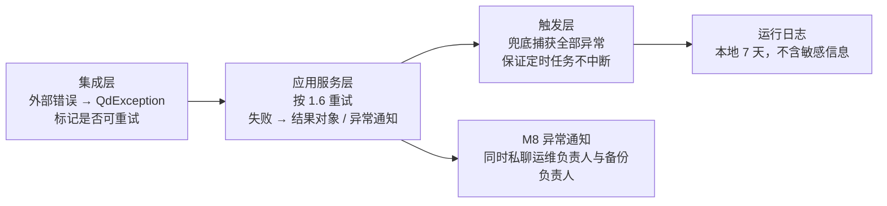
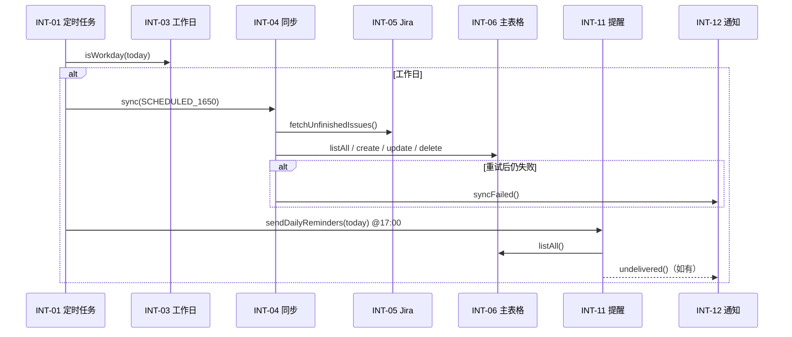
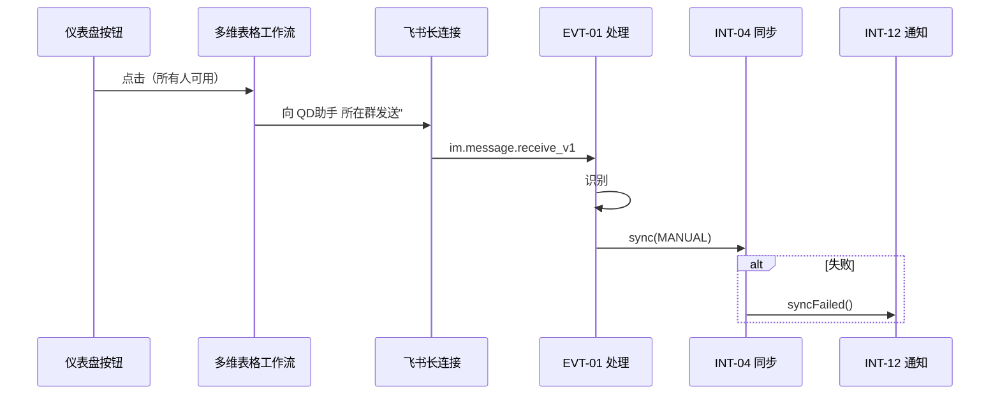

# QD助手 · 设计第四阶段：API 接口设计

| 项目 | 内容 |
|---|---|
| 文档版本 | v1.1（已审核通过；按技术验证 V2、V3 结论更新 EVT-01） |
| 日期 | 2026-11-26 |
| 依据 | [`01.功能模块梳理.md`](01.功能模块梳理.md) v0.4；[`02.整体架构设计.md`](02.整体架构设计.md) v1.2；[`03.数据格式设计.md`](03.数据格式设计.md) v0.2；[`需求文档.md`](../需求文档.md) v1.3 |
| 范围 | ✅ 已确认（方案 A）：**不对外提供 HTTP 接口**。本文设计三类接口：① 外部接口调用约定；② 长连接事件约定；③ 模块间内部接口 |
| 不含 | 业务代码、接口实现、对外 REST 接口、本机运维接口 |

> **为什么没有对外 REST 接口**：界面全部由飞书多维表格与消息承担（02 KD1）；所有连接由后端主动发起（02 KD3）；"立即同步"经飞书长连接触发（02 Q6、03 V3）。
>
> **状态标记**：🔒 约束（已确认）｜ 💡 建议（待确认，见第 8 章）｜ ⚠️ 依赖开发前 PoC（03 V1–V3）

---

## 1. 接口设计规范（✅ 已确认 Q1，已写入 `CLAUDE.md` 第 2 节）

> 本章于 2026-11-26 确认，摘要已写入 `CLAUDE.md`「2. API 接口设计规范」，后续开发须遵循。

### 1.1 命名与分包

| 对象 | 规则 | 示例 |
|---|---|---|
| 接口编号 | `EXT-`（外部调用）/ `EVT-`（事件）/ `INT-`（内部接口）+ 两位序号 | `EXT-J01`、`EVT-01`、`INT-02` |
| 包 | 按 02 第 5 章分层：`trigger` / `service` / `rule` / `integration.jira` / `integration.feishu` / `model` / `config` | `com.dreame.qd.service.SyncService` |
| 接口 / 类名 | 名词 + 职责后缀：`…Service`（编排）、`…Rule` / `…Resolver` / `…Composer`（规则）、`…Client` / `…Gateway`（集成）、`…Repository`（配置读取）、`…Store`（本地状态） | `RecipientResolver`、`TaskTableGateway` |
| 方法名 | 动词开头，表达业务意图 | `sync(trigger)`、`sendDailyReminders(date)` |
| 业务对象 | 沿用 03 第 8 章名称；本文新增的仅为方法出入参对象（见 7.3） | `SyncResult`、`ReminderTarget` |

### 1.2 统一结果结构

内部接口区分"**业务结果**"与"**异常**"：

| 情况 | 表达方式 | 说明 |
|---|---|---|
| 业务上的成功 / 部分成功 | 返回**结果对象**（如 `SyncResult`、`ReminderResult`），包含成功标志、数量、说明 | 例如"提醒发送完成，2 人未送达"是正常业务结果，不是异常 |
| 无法继续的失败 | 抛出 `QdException`（携带 `ErrorCode`） | 例如 Jira 认证失败、管理表格读取失败 |

所有结果对象的公共字段：

| 字段 | 类型 | 说明 |
|---|---|---|
| `success` | boolean | 本次动作是否成功 |
| `code` | String | 成功为 `OK`；失败为错误码（见 1.3） |
| `message` | String | 面向运维负责人的中文说明，**不含密码、App Secret 等敏感信息** |
| `finishedAt` | 时间（Asia/Shanghai） | 完成时间 |

### 1.3 错误码

格式：`QD-{分类}-{三位序号}`。

| 分类 | 含义 | 是否重试 | 是否通知运维负责人与备份负责人 |
|---|---|---|---|
| `JIRA` | 调用 Jira 失败 | 按 1.6 规则 | 是（重试后仍失败） |
| `FEISHU` | 调用飞书开放平台失败 | 按 1.6 规则 | 是（重试后仍失败；若是消息接口本身失败，仅写运行日志） |
| `CONFIG` | 配置缺失或错误（配置文件、管理表格内容） | 否 | 是（能发消息时）；启动时必需配置有误则拒绝启动（Q4） |
| `DATA` | 外部数据不符合预期（如缺少必需字段） | 否 | 单条数据跳过并写运行日志；整体不可用时通知 |
| `AUTH` | 预留（立即同步所有人可用，暂不使用） | 否 | 否 |
| `SYS` | 其他未预期错误 | 否 | 是 |

初始错误码清单：

| 错误码 | 含义 |
|---|---|
| `QD-JIRA-001` | Jira 认证失败（401） |
| `QD-JIRA-002` | Jira 拒绝访问（403，含验证码锁定 `CAPTCHA_CHALLENGE`） |
| `QD-JIRA-003` | Jira 限流（429） |
| `QD-JIRA-004` | Jira 超时或网络不可达 |
| `QD-JIRA-005` | Jira 服务端错误（5xx） |
| `QD-FEISHU-001` | 飞书访问令牌获取失败 |
| `QD-FEISHU-002` | 飞书接口无权限（应用权限或表格权限不足） |
| `QD-FEISHU-003` | 飞书接口限流 |
| `QD-FEISHU-004` | 飞书超时或网络不可达 |
| `QD-FEISHU-005` | 消息发送失败（单人） |
| `QD-CONFIG-001` | 必需配置项缺失（如密钥环境变量、表格 ID） |
| `QD-CONFIG-002` | 管理表格内容不合法（如节假日类型为空） |
| `QD-DATA-001` | Jira 数据缺少必需字段（如 key、status） |
| `QD-AUTH-001` | 停用（需求 v1.5：立即同步所有人可用，不再校验点击人） |
| `QD-AUTH-002` | 预留（Q3 确认不校验来源，暂不使用） |
| `QD-SYS-001` | 未预期错误 |

### 1.4 参数校验

| 位置 | 校验内容 | 校验失败的处理 |
|---|---|---|
| 启动时（配置） | 必需配置项与环境变量齐全、格式正确（时间格式、open_id 列表非空、表格 ID 可访问等） | ✅ 拒绝启动（Q4）：在控制台与运行日志列出每一项错误及修改方法；飞书相关配置正确时，同时通知运维负责人与备份负责人（`QD-CONFIG-001`） |
| 集成层（外部数据进入系统） | Jira Issue 必需字段（key、issuetype、status、statusCategory、created、updated）；飞书返回结构 | 单条缺字段 → 跳过该条并写运行日志（`QD-DATA-001`）；整体结构异常 → 抛 `QdException` |
| 配置读取（管理表格） | 03 第 3 章各表规则：空 Jira 账号忽略、重复取第一行、节假日类型冲突以"法定节假日"为准 | 按规则处理并写运行日志警告 |
| 事件入口 | EVT-01 只识别以 `#QD立即同步` 开头的消息（需求 v1.5：不校验点击人与来源） | 不符合则忽略 |
| 内部方法 | 入参非空、日期为北京时间 | 编程错误，抛 `IllegalArgumentException`（视为 `QD-SYS-001`） |

### 1.5 异常处理分层



| 层 | 职责 |
|---|---|
| 集成层 | 把 HTTP 状态码、超时、飞书错误码转换为 `QdException(ErrorCode, retryable)`；不做业务判断 |
| 应用服务层 | 执行重试；把最终结果组装为结果对象；需要时调用 M8 |
| 触发层 | 捕获所有未处理异常，写运行日志，**不让单次失败影响后续定时任务** |
| 运行日志 | 记录错误码、接口编号、耗时；**禁止**记录密码、App Secret、访问令牌、Authorization 请求头 |

### 1.6 外部调用约定

| 项目 | 约定 |
|---|---|
| 超时 | 连接 5 秒、读取 15 秒（可配置） |
| 重试 | 🔒 失败自动重试 **1 次**（F5.1、F5.5），间隔 2 秒；**仅对可重试错误**：超时 / 网络不可达、5xx、429（等待后重试） |
| 不重试的错误 | ✅ 401、403（含验证码锁定）、权限不足、参数错误 —— 重试只会加重 Jira 账号锁定（02 R11）；Jira 认证失败直接通知，通知中注明"可能是密码已修改或账号被锁定，请检查"（Q2） |
| 限流 | Jira：每分钟不超过 90 次（网关上限 100，02 E5）；飞书：按开放平台频率限制控制，批量接口优先 |
| 幂等 | 写主表格以 Issue 编号为唯一标识，整体对齐；同一次同步失败后重试不会产生重复记录 |
| 认证 | Jira：Basic Auth，账号密码来自环境变量 `QD_JIRA_USERNAME` / `QD_JIRA_PASSWORD`；飞书：应用身份（tenant_access_token），由官方 SDK 获取与刷新 |

### 1.7 权限校验

| 场景 | 校验方式 |
|---|---|
| 立即同步 | 不校验点击人与消息来源（需求 v1.5，所有人可用）；同步进行中再次请求直接忽略 |
| 访问管理表格 | 由飞书表格权限保证（仅朱卓、胡桓康），后端以应用身份只读，不做额外校验 |
| 访问主表格 | 由飞书知识库权限保证；后端以应用身份写入 |
| 定时任务 | 无外部调用方，无需权限校验 |

---

## 2. 接口清单总览

| 编号 | 名称 | 类别 | 所属模块 | 用途 | 需求依据 |
|---|---|---|---|---|---|
| EXT-J01 | 查询看板未完成任务 | 外部调用 | M1 | 拉取同步范围内 Story / 任务 / 三类 Bug | F1.1 |
| EXT-F01 | 获取飞书应用访问令牌 | 外部调用 | 集成层（公共） | 应用身份认证 | — |
| EXT-F02 | 查询多维表格记录 | 外部调用 | M4 / M7 | 读取主表格全部记录；读取管理表格三张表 | F1.3、F4 |
| EXT-F03 | 批量新增记录 | 外部调用 | M4 | 主表格新增任务 | F1.3 |
| EXT-F04 | 批量更新记录 | 外部调用 | M4 | 主表格更新任务 | F1.3 |
| EXT-F05 | 批量删除记录 | 外部调用 | M4 | 删除已完成 / 移出看板 / 已删除的任务 | R2 |
| EXT-F06 | 按邮箱查询飞书用户 | 外部调用 | M5 | Jira 账号 → 飞书 open_id | R3 |
| EXT-F07 | 发送私聊消息 | 外部调用 | M6 / M8 | 17:00 提醒、异常通知 | F3、F5 |
| EXT-F08 | 建立长连接并订阅事件 | 外部调用 | M3 | 接收"立即同步"请求 | F2.2、02 Q6 |
| EVT-01 | 立即同步请求事件 | 事件 | M3 | 仪表盘按钮 → 后端同步 | F2.2、F2.3 |
| INT-01 | 定时任务入口 | 内部 | M3 | 09:00 / 16:50 同步、17:00 提醒、年底日历检查 | F2.1、F3.1、F4.5 |
| INT-02 | 启动补执行 | 内部 | M3 | 恢复在线后补同步 / 补提醒 | F2.5、F3.6 |
| INT-03 | 工作日判断 | 内部 | M3 / M7 | 法定工作日、年份是否已录入 | F2.1、F4.4 |
| INT-04 | 执行同步 | 内部 | M2 | 一次完整同步（含重试） | F1、F5.1 |
| INT-05 | 读取 Jira 未完成任务 | 内部 | M1 | 封装 EXT-J01 与字段整理 | F1.1 |
| INT-06 | 主表格读写网关 | 内部 | M4 | 封装 EXT-F02–F05 | F1.3 |
| INT-07 | 读取管理表格配置 | 内部 | M7 | 排除名单、例外对应表、节假日日历 | F4 |
| INT-08 | 账号对应 | 内部 | M5 | Jira 人员 → 飞书人员 / 显示名 | R3、03 Q1 |
| INT-09 | 识别提醒对象 | 内部 | M5 | 归集、排除、未送达识别 | F3.3、F3.4 |
| INT-10 | 生成提醒消息 | 内部 | M6 | 按第 6 章规格组装 | F3.5、第 6 章 |
| INT-11 | 发送每日提醒 | 内部 | M6 | 编排一轮 17:00 提醒 | F3、F5.5 |
| INT-12 | 异常通知 | 内部 | M8 | 同步失败、未送达汇总、日历未录入 | F5.1、F5.2、F4.5 |
| INT-13 | 本地状态读写 | 内部 | M3 / M6 | 当日运行记录、已发送人员 | F3、02 Q3、Q8 |

---

## 3. 外部接口调用约定

> 字段映射以 03 第 4 章为准，本章不新增或修改任何表格字段。

### EXT-J01 查询看板未完成任务

| 项目 | 内容 |
|---|---|
| 请求 | `GET https://jira.dreame.tech/rest/api/2/search` |
| 认证 | Basic Auth（1.6） |
| 参数 | `jql` = 配置项 `qd.jira.board-jql`（D1：照搬看板 22909 的查询，已含 `statusCategory != Done`、类型与项目范围、4 个用户组限制，见 03 第 6 章）<br/>`fields` = `summary,issuetype,project,assignee,reporter,status,priority,created,updated`<br/>`startAt` = 0 起，每页递增<br/>`maxResults` = 100 |
| 响应（使用字段） | `total`、`issues[].key`、`issues[].fields.{summary, issuetype.name, project.key, assignee.{name,displayName,emailAddress}, reporter.{…}, status.name, status.statusCategory.key, priority.name, created, updated}` |
| 业务规则 | 循环分页直到取完 `total`；后端再次按 statusCategory 与类型名校验（03 4.1）；`assignee` 为空保留（03 Q3）；单条缺必需字段跳过（`QD-DATA-001`）；请求频率 ≤ 90 次 / 分钟 |
| 错误 | 401 → `QD-JIRA-001`、403 → `QD-JIRA-002`：**不重试**，直接通知（Q2）；429 → `QD-JIRA-003`、超时 → `QD-JIRA-004`、5xx → `QD-JIRA-005`：重试 1 次 |

### EXT-F01 获取飞书应用访问令牌

| 项目 | 内容 |
|---|---|
| 请求 | 由飞书官方 SDK 内部调用"自建应用获取 tenant_access_token"接口 |
| 参数 | `app_id`（配置 `feishu.app-id`）、`app_secret`（环境变量 `QD_FEISHU_APP_SECRET`） |
| 业务规则 | SDK 内存缓存并自动刷新；后端不自行保存令牌 |
| 错误 | `QD-FEISHU-001` |

### EXT-F02 查询多维表格记录

| 项目 | 内容 |
|---|---|
| 请求 | `POST /open-apis/bitable/v1/apps/{app_token}/tables/{table_id}/records/search` |
| 参数 | `page_size` ≤ 500、`page_token` 分页；`field_names` 按 03 各表字段 |
| 用途 | ① 主表格"未完成任务"全量读取（同步比对、17:00 提醒）；② 管理表格三张表读取 |
| 响应（使用字段） | `items[].record_id`、`items[].fields` |
| 业务规则 | 取完所有分页；主表格读取结果按 Issue 编号建立映射 |
| 错误 | 权限不足 → `QD-FEISHU-002`；限流 → `QD-FEISHU-003`；超时 → `QD-FEISHU-004` |

### EXT-F03 / F04 / F05 批量新增 / 更新 / 删除记录

| 项目 | 新增 | 更新 | 删除 |
|---|---|---|---|
| 请求 | `POST …/records/batch_create` | `POST …/records/batch_update` | `POST …/records/batch_delete` |
| 参数 | `records[].fields`（03 2.1 的 13 个字段） | `records[].{record_id, fields}` | `records`（record_id 列表） |
| 单次数量 | 按开放平台单次上限分批（新增上限 1000 条；其余以官方文档为准） | 同左 | 同左 |
| 业务规则 | 只写主表格"未完成任务"；人员字段写 open_id；日期写毫秒时间戳；单选值不存在时由飞书自动新增选项 | 只更新有变化的字段，"最后同步时间"每次都更新 | 删除"不再满足条件"的记录（R2） |

> 同步时的写入顺序：新增 → 更新 → 删除；任一批次失败视为本次同步失败，按 1.6 重试整个同步（以 Issue 编号整体对齐，可重入）。

### EXT-F06 按邮箱查询飞书用户

| 项目 | 内容 |
|---|---|
| 请求 | `POST /open-apis/contact/v3/users/batch_get_id?user_id_type=open_id` |
| 参数 | `emails`：每次 ≤ 50 个 |
| 响应（使用字段） | `user_list[].{email, user_id}`；查不到的邮箱不返回 `user_id` |
| 业务规则 | 查不到 → 查例外对应表（INT-08）；需要应用权限"通过手机号或邮箱获取用户 ID" |
| 错误 | `QD-FEISHU-002` / `003` / `004` |

### EXT-F07 发送私聊消息

| 项目 | 内容 |
|---|---|
| 请求 | `POST /open-apis/im/v1/messages?receive_id_type=open_id` |
| 参数 | `receive_id`（open_id）、`msg_type` = `interactive`、`content`（消息卡片 JSON，结构见 03 第 7 章） |
| 发送者 | 应用 QD助手（02 Q5） |
| 业务规则 | 每条提醒发送出错重试 1 次（F5.5）；账号不可用（离职 / 不在应用可用范围）不重试，计入未送达 |
| 错误 | `QD-FEISHU-005`（单人发送失败，计入未送达，不中断整轮发送） |

### EXT-F08 建立长连接并订阅事件（⚠️ V3）

| 项目 | 内容 |
|---|---|
| 方式 | 飞书官方 SDK 长连接（WebSocket）模式，由后端主动连接飞书，无需公网地址 |
| 订阅事件 | 💡 优先 `im.message.receive_v1`（接收消息）；PoC 不通过时改为写请求记录的保底方案（03 V3） |
| 业务规则 | 服务启动时建立；断开后由 SDK 自动重连；收到事件后交 EVT-01 处理 |

---

## 4. 事件约定

### EVT-01 立即同步请求事件（✅ V3 已验证；V2 不通过 → 所有人可用）

**触发链路**（2026-11-26 实测）：主表格仪表盘"立即同步"按钮 → 多维表格自动化 / 工作流 → 以**流程配置人**身份向 QD助手 所在群发送一条卡片消息 → QD助手 经长连接收到 `im.message.receive_v1` → 后端处理。

**消息内容约定**（流程中配置的消息正文）：

```
#QD立即同步
```

**后端解析**：

| 字段 | 来源 | 说明 |
|---|---|---|
| `messageType` | 事件 `message.message_type` | 流程发出的消息为 `interactive`（卡片） |
| `text` | 卡片 `content.user_dsl.body.elements[]` 中 `tag = markdown` 的 `content` 拼接 | 普通文本消息则取 `content.text` |
| `chatId`、`senderType`、`senderId` | 事件 `message`、`sender` | 仅用于运行日志；发送者恒为流程配置人，**无法代表点击人**（V2） |

**处理规则**：

| 顺序 | 规则 | 不满足时 |
|---|---|---|
| 1 | 正文以 `#QD立即同步` 开头 | 忽略（非本系统消息） |
| 2 | 当前没有正在进行的同步 | 忽略，写运行日志 |
| 3 | 调用 INT-04，`trigger = MANUAL` | — |
| 4 | **不发送提醒**（F2.3）；结果由仪表盘统计体现；失败由 INT-12 通知（03 Q2） | — |

> 📌 **立即同步所有人可用**（需求 v1.5）：技术验证 V2 证实工作流 / 自动化无法带出点击人、按钮不能限定范围；手动同步只读 Jira、整体对齐主表格、不发提醒，任何人触发都无副作用。原 Q3"只校验点击人、接受伪造风险"的结论由此失效。

---

## 5. 模块间内部接口

> 以下为方法级约定，参数与返回对象沿用 03 第 8 章的业务对象；"抛出"指 `QdException`。

### INT-01 定时任务入口（M3 · `trigger.ScheduledJobs`）

| 方法 | 时间（Asia/Shanghai） | 行为 |
|---|---|---|
| `runSync0900()` | 每天 09:00 | 工作日 → INT-04（`SCHEDULED_0900`）→ 记录 INT-13 `runs.sync0900` |
| `runSync1650()` | 每天 16:50 | 同上（`SCHEDULED_1650`） |
| `runRemind1700()` | 每天 17:00 | 工作日 → INT-11 → 记录 `runs.remind1700` |
| `runCalendarCheck()` | 每周一 09:00 | 12 月 1 日起且次年未录入 → INT-12 `calendarMissing`；当天只提醒一次（`lastCalendarCheck`） |

规则：非工作日直接返回（INT-03）；所有异常在此兜底捕获（1.5）。

### INT-02 启动补执行（M3 · `trigger.CatchUpRunner.runOnStartup()`）

| 情况 | 行为 |
|---|---|
| 今天是工作日，`runs.sync0900` / `sync1650` 应执行而缺失 | 立即执行一次 INT-04（`CATCH_UP`） |
| `runs.remind1700` 缺失、当前已过 17:00 且早于 20:00 | 先 INT-04，再 INT-11（`catchUp = true`） |
| 已过 20:00 或非工作日 | 不补 |

### INT-03 工作日判断（M3 / M7 · `rule.WorkdayCalendar`）

| 方法 | 入参 | 返回 | 规则 |
|---|---|---|---|
| `isWorkday(date, holidays)` | 日期、节假日日历 | boolean | 法定节假日 → false；调休补班 → true；其余周一至周五（含未录入年份，F4.4） |
| `isYearEntered(year, holidays)` | 年份、节假日日历 | boolean | 该年至少 1 行记录 |

### INT-04 执行同步（M2 · `service.SyncService`）

| 方法 | `SyncResult sync(SyncTrigger trigger)` |
|---|---|
| 入参 | `trigger`：`SCHEDULED_0900` / `SCHEDULED_1650` / `MANUAL` / `CATCH_UP` |
| 返回 | `SyncResult`（03 第 8 章：trigger、success、count、retried、message、finishedAt；另含 1.2 公共字段 `code`） |
| 步骤 | INT-05 拉取 → INT-08 账号对应 → 计算未完成集合（R2）→ INT-06 读取现有记录并新增 / 更新 / 删除 → 写"最后同步时间" |
| 规则 | 同一时刻只允许一个同步（加锁）；失败按 1.6 重试 1 次；重试后仍失败 → `success=false` 并调用 INT-12 `syncFailed`；失败时主表格保持原数据 |
| 抛出 | 不向调用方抛出业务异常（结果对象表达）；仅未预期错误抛 `QD-SYS-001` |

### INT-05 读取 Jira 未完成任务（M1 · `integration.jira.JiraClient`）

| 方法 | `List<JiraIssue> fetchUnfinishedIssues()` |
|---|---|
| 说明 | 封装 EXT-J01 分页、限流与字段整理 |
| 抛出 | `QD-JIRA-001…005`（携带是否可重试） |

### INT-06 主表格读写网关（M4 · `integration.feishu.TaskTableGateway`）

| 方法 | 说明 |
|---|---|
| `List<TaskRow> listAll()` | EXT-F02，读取全部记录（含 record_id） |
| `void createBatch(List<TaskRow>)` | EXT-F03 |
| `void updateBatch(List<TaskRow>)` | EXT-F04 |
| `void deleteBatch(List<String> recordIds)` | EXT-F05 |

字段严格对应 03 2.1 的 13 个字段；抛出 `QD-FEISHU-*`。

### INT-07 读取管理表格配置（M7 · `integration.feishu.AdminConfigRepository`）

| 方法 | `AdminConfig load()` |
|---|---|
| 返回 | `AdminConfig`：excludes、mappings、holidays（03 第 8 章） |
| 规则 | 每次执行时实时读取，不缓存（F4 验收）；按 03 第 3 章规则清洗；读取失败抛 `QD-FEISHU-*` |

### INT-08 账号对应（M5 · `rule.AccountMapper`）

| 方法 | `Map<String, PersonRef> map(Collection<JiraUser> users, List<Mapping> mappings)` |
|---|---|
| 规则 | ① EXT-F06 按邮箱查 open_id；② 查不到查例外对应表；③ 仍查不到 → `mapped=false`，`displayText = "Jira 姓名（未对应）"`；无经办人由调用方处理为"未分配"（03 Q3） |
| 输出用途 | 主表格"经办人""经办人（显示）""报告人"写入值（03 2.2）；提醒对象识别 |

### INT-09 识别提醒对象（M5 · `rule.RecipientResolver`）

| 方法 | `RecipientResolution resolve(List<TaskRow> rows, AdminConfig config)` |
|---|---|
| 返回 | `RecipientResolution`：`targets: List<ReminderTarget>`、`undelivered: List<Undelivered>` |
| 规则 | 按经办人归集；跳过无经办人（03 Q3）；扣除排除名单；未对应 → 未送达（账号无法对应）；飞书账号不可用 → 未送达（已离职 / 停用） |

### INT-10 生成提醒消息（M6 · `rule.ReminderComposer`）

| 方法 | `ReminderMessage compose(ReminderTarget target, Instant dataAsOf)` |
|---|---|
| 规则 | 按 Story / Task / Bug 三段，每段"共 N 条"（N 为 0 也显示，01 Q5）+ 最多 3 条，按创建时间早→晚；每条：编号（链接）+ 标题 + Jira 状态；附"查看全部 → 我的未完成"链接与"数据截至"时间（03 7.1） |
| 说明 | 纯规则，无外部调用，单元测试重点 |

### INT-11 发送每日提醒（M6 · `service.ReminderService`）

| 方法 | `ReminderResult sendDailyReminders(LocalDate date, boolean catchUp)` |
|---|---|
| 返回 | `ReminderResult`：sentCount、skippedCount（当天已发）、retriedCount、undelivered |
| 步骤 | INT-06 读取主表格 → INT-07 读取配置 → INT-09 识别 → 逐人：已发过则跳过（INT-13）→ INT-10 → EXT-F07（出错重试 1 次）→ 成功记 INT-13 → 汇总未送达 → INT-12 `undelivered` |
| 规则 | 数据截至 = 最近一次成功同步时间（F5.3）；单人失败不中断整轮 |

### INT-12 异常通知（M8 · `service.AlertService`）

| 方法 | 触发 | 内容（03 7.2） |
|---|---|---|
| `syncFailed(SyncResult)` | 同步重试后仍失败 | 失败的同步、时间、原因摘要、已重试、表格数据截至时间 |
| `undelivered(LocalDate, List<Undelivered>)` | 17:00 发送后存在未送达 | 未送达人数与逐人原因 |
| `calendarMissing(int year)` | 年底检查发现次年未录入 | 缺失年份、判断方式、录入位置 |

规则：同时发送给 `ops-open-ids` 与 `backup-open-ids`（01 Q3）；通知本身发送失败只写运行日志，不再递归通知。

### INT-13 本地状态读写（M3 / M6 · `integration.local.DailyStateStore`）

| 方法 | 说明 |
|---|---|
| `DailyState load(LocalDate today)` | 读取 `reminder-state.json`；日期不是今天则返回空状态 |
| `void markRun(String job, Instant at)` | 记录 `runs.{sync0900,sync1650,remind1700}` |
| `boolean isSent(String openId)` / `void markSent(String openId)` | 每人每天最多 1 条（F3） |
| `void markCalendarChecked(LocalDate)` | 记录 `lastCalendarCheck` |

规则：每次写入立即落盘；文件格式见 03 第 5 章。

---

## 6. 核心调用时序

### 6.1 定时同步与 17:00 提醒



### 6.2 立即同步



---

## 7. 一致性检查

### 7.1 需求覆盖

| 需求 | 接口 |
|---|---|
| F1 同步（拉取、只保留未完成、去重、最后同步时间） | EXT-J01、EXT-F02–F05、INT-04、INT-05、INT-06 |
| F2.1 定时同步（法定工作日） | INT-01、INT-03 |
| F2.2–F2.4 立即同步（所有人可用）、不发提醒、结果展示 | EVT-01、EXT-F08、INT-04（结果由仪表盘统计，无需接口） |
| F2.5 / F3.6 补执行 | INT-02、INT-13 |
| F3 17:00 提醒、每人每天 1 条、排除名单 | INT-01、INT-09、INT-10、INT-11、EXT-F07、INT-13 |
| R3 账号对应、例外对应表 | INT-08、EXT-F06、INT-07 |
| F4 管理表格三类配置 | INT-07、INT-03 |
| F4.5 年底日历检查 | INT-01 `runCalendarCheck`、INT-12 `calendarMissing` |
| F5.1–F5.5 重试、通知两人、未送达汇总、数据截至、发送重试 | 1.6、INT-04、INT-11、INT-12 |
| 第 6 章消息格式 | INT-10 |

### 7.2 架构一致性

| 检查项 | 结论 |
|---|---|
| 不对外提供 HTTP（KD1、KD3） | ✅ 所有 EXT 接口均由后端主动调用；EVT-01 经长连接接收 |
| 分层（02 3.2） | ✅ INT-01/02 触发层；INT-04/11/12 应用服务层；INT-03/08/09/10 规则层；INT-05/06/07/13 集成层 |
| 依赖方向（02 4.2） | ✅ 触发 → 服务 → 规则 / 网关，无循环依赖 |
| 单实例、不引入数据库与缓存（KD2、KD4） | ✅ 状态仅 INT-13 本地文件 |

### 7.3 与数据格式设计的一致性

| 检查项 | 结论 |
|---|---|
| 主表格字段 | ✅ 仅使用 03 2.1 的 13 个字段，未新增或修改 |
| 管理表格字段 | ✅ 仅使用 03 第 3 章字段 |
| 本地状态文件 | ✅ 字段与 03 第 5 章一致 |
| 配置项 | ✅ 使用 03 第 6 章配置；新增的超时、重试间隔为可选配置项（不涉及表格） |
| 业务对象 | ⚠️ 新增 3 个**方法出入参对象**（非表格字段）：`ReminderResult`、`RecipientResolution`、`ReminderMessage`；`SyncResult` 增加公共字段 `code`。需补充到 03 第 8 章（见第 9 章） |

### 7.4 完整性检查（2026-11-26）

| 检查项 | 结果 |
|---|---|
| 接口数量 | 共 **23 个**：外部调用 9 个（EXT-J01、EXT-F01–F08）、事件 1 个（EVT-01）、内部接口 13 个（INT-01–13） |
| 清单与详情 | 23 个接口均在第 2 章清单中，且第 3–5 章均有对应详情；正文引用的接口编号均已定义 |
| 待确认问题 | Q1–Q4 已全部确认；剩余不确定项仅为开发前 PoC（V1–V3） |
| 前序文档同步 | 第 9 章各项已同步至需求文档 v1.4、03 v0.3、`CLAUDE.md` 第 2 节 |

---

## 8. 待确认问题

| # | 问题 | 为什么要确认 | 我的建议 |
|---|---|---|---|
| ~~Q1~~ | ~~是否认可第 1 章的接口设计规范，并写入 `CLAUDE.md`？~~ | ✅ 已确认：认可，已写入 `CLAUDE.md` 第 2 节 | — |
| ~~Q2~~ | ~~Jira 认证类错误（401 / 403）是否不重试？~~ | ✅ 已确认（方案 A）：认证类错误不重试、直接通知并提示检查密码 / 账号锁定；其他可重试错误仍重试 1 次 | — |
| ~~Q3~~ | ~~立即同步消息的来源如何校验？~~ | ✅ 已确认（方案 B），**后经技术验证 V2 失效**：点击人无法取得，立即同步改为所有人可用，不校验点击人与来源 | — |
| ~~Q4~~ | ~~启动时配置错误怎么处理？~~ | ✅ 已确认（方案 A）：拒绝启动；控制台与运行日志列出错误；能发消息时同时通知运维负责人与备份负责人 | — |

### 需验证（开发前 PoC，沿用 03）

| # | 验证项 | 影响接口 |
|---|---|---|
| V1 | ~~视图能否按"当前用户"筛选人员字段~~ | ✅ 改用高级权限实现（03 §2.5）；无接口影响 |
| V2 | ~~仪表盘按钮可选范围、工作流能否带出点击人~~ | ❌ 不通过 → 所有人可用（EVT-01 已更新） |
| V3 | ~~工作流发出的消息能否被 QD助手 经长连接收到~~ | ✅ 通过（卡片消息，解析规则见 EVT-01） |

---

## 9. 对前序文档的影响

| 结论 | 影响的文档 | 需要修订的内容 | 状态 |
|---|---|---|---|
| Q2 认证失败不重试 | 需求文档 F5.1 | 细化为"仅对临时性故障（超时 / 网络、5xx、限流）重试 1 次；Jira 认证失败（401 / 403）不重试，直接通知" | ✅ 已同步（2026-11-26） |
| 新增方法出入参对象 | 03 第 8 章 | 补充 `ReminderResult`、`RecipientResolution`、`ReminderMessage`；`SyncResult` 增加 `code` | ✅ 已同步（2026-11-26） |
| 新增可选配置项 | 03 第 6 章 | 超时（连接 / 读取）、重试间隔（Q3 确认不需要指定会话 ID） | ✅ 已同步（2026-11-26） |
| Q3 只校验点击人 | 需求文档 F2.2、第 8 章风险 | 注明"仅管理员可操作"由按钮可选范围 + 点击人校验保证，不校验消息来源，存在可被伪造触发的风险（影响有限） | ✅ 已同步（2026-11-26） |
| 规范写入 | `CLAUDE.md` | 新增"2. API 接口设计规范"一节 | ✅ 已完成（2026-11-26） |

---

## 10. 审核决策记录

| # | 问题 | 结论 | 日期 |
|---|---|---|---|
| 范围 | API 接口设计范围 | A：不对外提供 HTTP；设计外部调用约定、事件约定、内部接口 | 2026-11-26 |
| 规范来源 | 接口设计规范从哪里来 | A：先在本文提出建议，确认后写入 `CLAUDE.md` | 2026-11-26 |
| Q1 | 第 1 章接口设计规范 | 认可，已写入 `CLAUDE.md` 第 2 节 | 2026-11-26 |
| Q2 | Jira 认证失败是否重试 | A：不重试，直接通知 | 2026-11-26 |
| Q3 | 立即同步消息来源校验 | B：只校验点击人，接受伪造风险 | 2026-11-26 |
| Q4 | 启动时配置错误 | A：拒绝启动并列出错误；能发消息时通知两人 | 2026-11-26 |
| — | 第四阶段整体审核 | 审核通过 | 2026-11-26 |
| — | 技术验证 V2 / V3 | EVT-01 改为所有人可用；消息为卡片格式；`QD-AUTH-001` 停用；Q3 失效 | 2026-11-26 |
